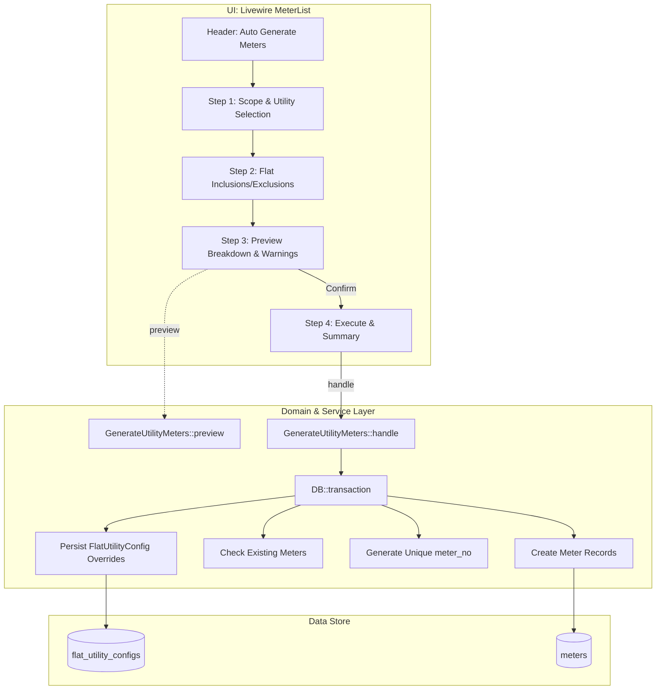

# Automatic Utility Meter Generation and Flat-Based Meter Management Implementation Plan

> **For agentic workers:** REQUIRED SUB-SKILL: Use superpowers:subagent-driven-development to implement this plan task-by-task. Steps use checkbox (`- [ ]`) syntax for tracking.

**Goal:** Provide an automated, idempotent utility meter generation engine allowing operators to provision utility meters (electricity, gas, water) across multiple flats in a single operation, with persistent flat-level requirement controls, comprehensive pre-flight preview calculations, and zero accounting or billing side-effects.

**Architecture:**
1. `flat_utility_configs` table models whether a flat requires a utility connection (`is_enabled`) distinctly from physical meter records.
2. `UtilitySeeder` ensures default utilities (Electricity, Gas, Water) exist idempotently per building linked to income accounts.
3. `GenerateUtilityMeters` domain service provides `preview()` for pre-flight stats (eligible, skipped, inactive warnings, excluded) and `handle()` for transactional bulk creation with pattern-based numbering (`{PREFIX}-{FLAT_NUMBER}`).
4. `MeterList` Livewire screen embeds a full multi-step modal wizard for scoping, flat-level overrides, preview inspection, and execution summary.

**Architecture Diagram:**



**Tech Stack:** PHP 8.5, Laravel 13, Livewire 4, PostgreSQL 18, Tailwind CSS 4, PHPUnit 12.

## Global Constraints

- Never mutate, backfill, or invent `MeterReading`, `service_charge_bills`, or `journal_lines` records.
- Preserve composite unique constraint on `meters`: `['utility_id', 'meter_no']`.
- Scoping must strictly respect `CurrentBuilding` / `building_id`.
- Follow strict typing with PHP 8 constructor promotion and explicit return types.
- Ensure 100% bilingual parity across English and Bangla translation files (`lang/en/utilities.php` and `lang/bn/utilities.php`).
- Pass `composer check` (tests, Larastan, Pint) with 0 errors.

---

### Task 1: Database Migration and Model for Flat Utility Configurations

**Files:**
- Create: `database/migrations/2026_10_11_160000_create_flat_utility_configs_table.php`
- Create: `app/Models/FlatUtilityConfig.php`
- Modify: `app/Models/Flat.php`
- Modify: `app/Models/Utility.php`
- Test: `tests/Feature/Utilities/FlatUtilityConfigTest.php`

**Interfaces:**
- Consumes: `Flat $flat`, `Utility $utility`
- Produces: `FlatUtilityConfig` Eloquent model with `$flat->utilityConfigs()` and `$utility->flatConfigs()` relationships.

- [ ] **Step 1: Write the failing test**

Create `tests/Feature/Utilities/FlatUtilityConfigTest.php`:
```php
<?php

namespace Tests\Feature\Utilities;

use App\Models\Building;
use App\Models\Flat;
use App\Models\FlatUtilityConfig;
use App\Models\Utility;
use Illuminate\Foundation\Testing\RefreshDatabase;
use Tests\TestCase;

class FlatUtilityConfigTest extends TestCase
{
    use RefreshDatabase;

    public function test_it_persists_flat_utility_configuration(): void
    {
        $building = Building::factory()->create();
        $flat = Flat::factory()->create(['building_id' => $building->id]);
        $utility = Utility::factory()->create(['building_id' => $building->id]);

        $config = FlatUtilityConfig::create([
            'flat_id' => $flat->id,
            'utility_id' => $utility->id,
            'is_enabled' => false,
        ]);

        $this->assertDatabaseHas('flat_utility_configs', [
            'id' => $config->id,
            'flat_id' => $flat->id,
            'utility_id' => $utility->id,
            'is_enabled' => false,
        ]);

        $this->assertTrue($flat->utilityConfigs()->where('utility_id', $utility->id)->exists());
    }
}
```

- [ ] **Step 2: Run test to verify it fails**

Run: `php artisan test tests/Feature/Utilities/FlatUtilityConfigTest.php`
Expected: FAIL with missing table or class `FlatUtilityConfig`.

- [ ] **Step 3: Create migration and model**

Create migration `database/migrations/2026_10_11_160000_create_flat_utility_configs_table.php`:
```php
<?php

use Illuminate\Database\Migrations\Migration;
use Illuminate\Database\Schema\Blueprint;
use Illuminate\Support\Facades\Schema;

return new class extends Migration
{
    public function up(): void
    {
        Schema::create('flat_utility_configs', function (Blueprint $table): void {
            $table->id();
            $table->foreignId('flat_id')->constrained()->cascadeOnDelete();
            $table->foreignId('utility_id')->constrained()->cascadeOnDelete();
            $table->boolean('is_enabled')->default(true);
            $table->timestamps();

            $table->unique(['flat_id', 'utility_id']);
            $table->index('utility_id');
        });
    }

    public function down(): void
    {
        Schema::dropIfExists('flat_utility_configs');
    }
};
```

Create `app/Models/FlatUtilityConfig.php`:
```php
<?php

namespace App\Models;

use Illuminate\Database\Eloquent\Attributes\Fillable;
use Illuminate\Database\Eloquent\Model;
use Illuminate\Database\Eloquent\Relations\BelongsTo;

/**
 * @property int $id
 * @property int $flat_id
 * @property int $utility_id
 * @property bool $is_enabled
 */
#[Fillable(['flat_id', 'utility_id', 'is_enabled'])]
class FlatUtilityConfig extends Model
{
    protected function casts(): array
    {
        return [
            'is_enabled' => 'boolean',
        ];
    }

    /** @return BelongsTo<Flat, $this> */
    public function flat(): BelongsTo
    {
        return $this->belongsTo(Flat::class);
    }

    /** @return BelongsTo<Utility, $this> */
    public function utility(): BelongsTo
    {
        return $this->belongsTo(Utility::class);
    }
}
```

Add relationships in `app/Models/Flat.php`:
```php
    /** @return HasMany<FlatUtilityConfig, $this> */
    public function utilityConfigs(): HasMany
    {
        return $this->hasMany(FlatUtilityConfig::class);
    }

    /** @return HasMany<Meter, $this> */
    public function meters(): HasMany
    {
        return $this->hasMany(Meter::class);
    }
```

Add relationship in `app/Models/Utility.php`:
```php
    /** @return HasMany<FlatUtilityConfig, $this> */
    public function flatConfigs(): HasMany
    {
        return $this->hasMany(FlatUtilityConfig::class);
    }
```

- [ ] **Step 4: Run test to verify it passes**

Run: `php artisan test tests/Feature/Utilities/FlatUtilityConfigTest.php`
Expected: PASS

- [ ] **Step 5: Format and commit**

```bash
vendor/bin/pint --dirty --format agent
git add database/migrations/2026_10_11_160000_create_flat_utility_configs_table.php app/Models/FlatUtilityConfig.php app/Models/Flat.php app/Models/Utility.php tests/Feature/Utilities/FlatUtilityConfigTest.php
git commit -m "feat(utilities): create flat_utility_configs table and relationships"
```

---

### Task 2: Idempotent Utility Seeder for Default Utility Types

**Files:**
- Create: `database/seeders/UtilitySeeder.php`
- Modify: `database/seeders/DatabaseSeeder.php`
- Modify: `database/seeders/DemoBuildingSeeder.php`
- Test: `tests/Feature/Utilities/UtilitySeederTest.php`

**Interfaces:**
- Consumes: `Building $building`
- Produces: Default Electricity, Gas, and Water `Utility` records linked to the building's income account.

- [ ] **Step 1: Write the failing test**

Create `tests/Feature/Utilities/UtilitySeederTest.php`:
```php
<?php

namespace Tests\Feature\Utilities;

use App\Models\Building;
use App\Models\Utility;
use Database\Seeders\ChartOfAccountsSeeder;
use Database\Seeders\UtilitySeeder;
use Illuminate\Foundation\Testing\RefreshDatabase;
use Tests\TestCase;

class UtilitySeederTest extends TestCase
{
    use RefreshDatabase;

    public function test_it_seeds_default_utilities_idempotently(): void
    {
        $this->seed(ChartOfAccountsSeeder::class);
        $building = Building::factory()->create();

        $seeder = new UtilitySeeder;
        $seeder->seedForBuilding($building);

        $this->assertSame(3, Utility::where('building_id', $building->id)->count());
        $this->assertDatabaseHas('utilities', ['building_id' => $building->id, 'name' => 'Electricity']);
        $this->assertDatabaseHas('utilities', ['building_id' => $building->id, 'name' => 'Gas']);
        $this->assertDatabaseHas('utilities', ['building_id' => $building->id, 'name' => 'Water']);

        // Second run must not create duplicates
        $seeder->seedForBuilding($building);
        $this->assertSame(3, Utility::where('building_id', $building->id)->count());
    }
}
```

- [ ] **Step 2: Run test to verify it fails**

Run: `php artisan test tests/Feature/Utilities/UtilitySeederTest.php`
Expected: FAIL with `UtilitySeeder not found`.

- [ ] **Step 3: Implement UtilitySeeder**

Create `database/seeders/UtilitySeeder.php`:
```php
<?php

namespace Database\Seeders;

use App\Enums\AccountCode;
use App\Enums\AccountType;
use App\Models\Account;
use App\Models\Building;
use App\Models\Utility;
use Illuminate\Database\Seeder;

class UtilitySeeder extends Seeder
{
    private const DEFAULTS = [
        [
            'name' => 'Electricity',
            'name_bn' => 'বিদ্যুৎ',
            'unit_label' => 'kWh',
            'sort_order' => 1,
        ],
        [
            'name' => 'Gas',
            'name_bn' => 'গ্যাস',
            'unit_label' => 'm³',
            'sort_order' => 2,
        ],
        [
            'name' => 'Water',
            'name_bn' => 'পানি',
            'unit_label' => 'Unit',
            'sort_order' => 3,
        ],
    ];

    public function run(): void
    {
        foreach (Building::all() as $building) {
            $this->seedForBuilding($building);
        }
    }

    public function seedForBuilding(Building $building): void
    {
        $account = Account::where('is_postable', true)
            ->where('is_active', true)
            ->where('type', AccountType::Income)
            ->orderBy('code')
            ->first();

        if ($account === null) {
            return;
        }

        foreach (self::DEFAULTS as $data) {
            Utility::firstOrCreate(
                [
                    'building_id' => $building->id,
                    'name' => $data['name'],
                ],
                [
                    'account_id' => $account->id,
                    'name_bn' => $data['name_bn'],
                    'unit_label' => $data['unit_label'],
                    'sort_order' => $data['sort_order'],
                    'is_active' => true,
                ],
            );
        }
    }
}
```

Update `database/seeders/DemoBuildingSeeder.php` to invoke `app(UtilitySeeder::class)->seedForBuilding($building)`.

- [ ] **Step 4: Run test to verify it passes**

Run: `php artisan test tests/Feature/Utilities/UtilitySeederTest.php`
Expected: PASS

- [ ] **Step 5: Format and commit**

```bash
vendor/bin/pint --dirty --format agent
git add database/seeders/UtilitySeeder.php database/seeders/DemoBuildingSeeder.php tests/Feature/Utilities/UtilitySeederTest.php
git commit -m "feat(utilities): implement idempotent UtilitySeeder for default utility types"
```

---

### Task 3: `GenerateUtilityMeters` Domain Service & Support Data DTOs

**Files:**
- Create: `app/Support/MeterGenerationPreviewData.php`
- Create: `app/Support/MeterGenerationResultData.php`
- Create: `app/Services/Utilities/GenerateUtilityMeters.php`
- Test: `tests/Feature/Utilities/GenerateUtilityMetersTest.php`

**Interfaces:**
- Consumes: `Building $building`, `array $flatIds`, `array $utilityIds`, `array $utilityPrefixes`, `array $flatUtilityOverrides`
- Produces: `MeterGenerationPreviewData` (preview metrics and detailed skip reasons) and `MeterGenerationResultData` (transactional creation results).

- [ ] **Step 1: Write the failing tests**

Create `tests/Feature/Utilities/GenerateUtilityMetersTest.php` testing:
1. Generation for 120 flats across multiple utilities.
2. Skipping flats with existing active meters.
3. Reporting warnings for flats with inactive meters.
4. Exclusions via `flat_utility_configs` or explicit parameter overrides.
5. Absolute idempotency (running twice leaves counts identical and skips all).
6. Tenant/building isolation (no foreign building flats affected).
7. Zero accounting impact (no bills or readings created).

```php
<?php

namespace Tests\Feature\Utilities;

use App\Models\Building;
use App\Models\Flat;
use App\Models\FlatUtilityConfig;
use App\Models\Meter;
use App\Models\MeterReading;
use App\Models\ServiceChargeBill;
use App\Models\Utility;
use App\Services\Utilities\GenerateUtilityMeters;
use Illuminate\Foundation\Testing\RefreshDatabase;
use Tests\TestCase;

class GenerateUtilityMetersTest extends TestCase
{
    use RefreshDatabase;

    public function test_it_previews_and_generates_meters_for_multiple_flats_and_utilities(): void
    {
        $building = Building::factory()->create();
        $flats = Flat::factory()->count(10)->create(['building_id' => $building->id]);
        $electricity = Utility::factory()->create(['building_id' => $building->id, 'name' => 'Electricity']);
        $gas = Utility::factory()->create(['building_id' => $building->id, 'name' => 'Gas']);

        $service = new GenerateUtilityMeters;
        $flatIds = $flats->pluck('id')->all();
        $utilityIds = [$electricity->id, $gas->id];

        // Preview check
        $preview = $service->preview($building, $flatIds, $utilityIds);
        $this->assertSame(10, $preview->totalFlatsCount);
        $this->assertSame(20, $preview->eligibleMetersCount);
        $this->assertSame(0, $preview->skippedMetersCount);

        // Execute generation
        $result = $service->handle($building, $flatIds, $utilityIds, [
            $electricity->id => 'ELEC',
            $gas->id => 'GAS',
        ]);

        $this->assertSame(10, $result->flatsConsidered);
        $this->assertSame(20, $result->metersCreated);
        $this->assertSame(0, $result->metersSkipped);
        $this->assertSame(20, Meter::where('building_id', $building->id)->count());

        // Assert meter numbers
        $sampleMeter = Meter::where('flat_id', $flats->first()->id)->where('utility_id', $electricity->id)->firstOrFail();
        $this->assertSame("ELEC-{$flats->first()->number}", $sampleMeter->meter_no);

        // Assert downstream safety: 0 readings, 0 bills
        $this->assertSame(0, MeterReading::count());
        $this->assertSame(0, ServiceChargeBill::count());

        // Idempotency: Re-run should skip all 20
        $rerunResult = $service->handle($building, $flatIds, $utilityIds);
        $this->assertSame(0, $rerunResult->metersCreated);
        $this->assertSame(20, $rerunResult->metersSkipped);
    }

    public function test_it_respects_flat_exclusions_and_inactive_meter_warnings(): void
    {
        $building = Building::factory()->create();
        $flat1 = Flat::factory()->create(['building_id' => $building->id, 'number' => '1A']);
        $flat2 = Flat::factory()->create(['building_id' => $building->id, 'number' => '1B']);
        $utility = Utility::factory()->create(['building_id' => $building->id, 'name' => 'Gas']);

        // Flat 1 is excluded from gas
        FlatUtilityConfig::create([
            'flat_id' => $flat1->id,
            'utility_id' => $utility->id,
            'is_enabled' => false,
        ]);

        // Flat 2 has an existing inactive meter
        Meter::factory()->create([
            'building_id' => $building->id,
            'flat_id' => $flat2->id,
            'utility_id' => $utility->id,
            'meter_no' => 'OLD-GAS',
            'is_active' => false,
        ]);

        $service = new GenerateUtilityMeters;
        $preview = $service->preview($building, [$flat1->id, $flat2->id], [$utility->id]);

        $this->assertSame(0, $preview->eligibleMetersCount);
        $this->assertSame(1, $preview->excludedFlatsCount);
        $this->assertSame(1, $preview->skippedMetersCount);
        $this->assertCount(1, $preview->inactiveWarnings);

        $result = $service->handle($building, [$flat1->id, $flat2->id], [$utility->id]);
        $this->assertSame(0, $result->metersCreated);
        $this->assertSame(1, $result->metersSkipped);
        $this->assertSame(1, $result->flatsExcluded);
    }
}
```

- [ ] **Step 2: Run test to verify it fails**

Run: `php artisan test tests/Feature/Utilities/GenerateUtilityMetersTest.php`
Expected: FAIL with `GenerateUtilityMeters class not found`.

- [ ] **Step 3: Implement Support DTOs and Service**

Create `app/Support/MeterGenerationPreviewData.php`:
```php
<?php

namespace App\Support;

class MeterGenerationPreviewData
{
    /**
     * @param list<array{flat_id: int, flat_number: string, utility_id: int, utility_name: string, reason: string}> $skippedDetails
     * @param list<array{flat_id: int, flat_number: string, utility_id: int, utility_name: string, meter_no: string}> $inactiveWarnings
     * @param array<int, int> $utilityCounts
     */
    public function __construct(
        public readonly int $totalFlatsCount,
        public readonly int $eligibleMetersCount,
        public readonly int $skippedMetersCount,
        public readonly int $excludedFlatsCount,
        public readonly array $skippedDetails = [],
        public readonly array $inactiveWarnings = [],
        public readonly array $utilityCounts = [],
    ) {}
}
```

Create `app/Support/MeterGenerationResultData.php`:
```php
<?php

namespace App\Support;

class MeterGenerationResultData
{
    /**
     * @param list<string> $errors
     */
    public function __construct(
        public readonly int $flatsConsidered,
        public readonly int $metersCreated,
        public readonly int $metersSkipped,
        public readonly int $flatsExcluded,
        public readonly array $errors = [],
    ) {}
}
```

Create `app/Services/Utilities/GenerateUtilityMeters.php`:
```php
<?php

namespace App\Services\Utilities;

use App\Models\Building;
use App\Models\Flat;
use App\Models\FlatUtilityConfig;
use App\Models\Meter;
use App\Models\Utility;
use App\Support\MeterGenerationPreviewData;
use App\Support\MeterGenerationResultData;
use Illuminate\Support\Facades\DB;
use Illuminate\Support\Str;

class GenerateUtilityMeters
{
    /**
     * @param list<int> $flatIds
     * @param list<int> $utilityIds
     * @param array<string, bool> $flatUtilityOverrides
     */
    public function preview(
        Building $building,
        array $flatIds,
        array $utilityIds,
        array $flatUtilityOverrides = [],
    ): MeterGenerationPreviewData {
        $flats = Flat::where('building_id', $building->id)
            ->whereIn('id', $flatIds)
            ->get();

        $utilities = Utility::where('building_id', $building->id)
            ->whereIn('id', $utilityIds)
            ->get();

        $existingMeters = Meter::where('building_id', $building->id)
            ->whereIn('flat_id', $flats->pluck('id'))
            ->whereIn('utility_id', $utilities->pluck('id'))
            ->get();

        $savedConfigs = FlatUtilityConfig::whereIn('flat_id', $flats->pluck('id'))
            ->whereIn('utility_id', $utilities->pluck('id'))
            ->get()
            ->keyBy(fn ($c) => "{$c->flat_id}-{$c->utility_id}");

        $eligibleCount = 0;
        $skippedCount = 0;
        $excludedCount = 0;
        $skippedDetails = [];
        $inactiveWarnings = [];
        $utilityCounts = [];

        foreach ($utilities as $utility) {
            $utilityCounts[$utility->id] = 0;

            foreach ($flats as $flat) {
                $overrideKey = "{$flat->id}-{$utility->id}";
                $isEnabled = $flatUtilityOverrides[$overrideKey] ?? ($savedConfigs->get($overrideKey)?->is_enabled ?? true);

                if (! $isEnabled) {
                    $excludedCount++;
                    $skippedDetails[] = [
                        'flat_id' => $flat->id,
                        'flat_number' => $flat->number,
                        'utility_id' => $utility->id,
                        'utility_name' => $utility->displayName(),
                        'reason' => 'Excluded by configuration',
                    ];
                    continue;
                }

                $existing = $existingMeters->first(fn ($m) => $m->flat_id === $flat->id && $m->utility_id === $utility->id);

                if ($existing !== null) {
                    $skippedCount++;
                    if (! $existing->is_active) {
                        $inactiveWarnings[] = [
                            'flat_id' => $flat->id,
                            'flat_number' => $flat->number,
                            'utility_id' => $utility->id,
                            'utility_name' => $utility->displayName(),
                            'meter_no' => $existing->meter_no,
                        ];
                    }
                    $skippedDetails[] = [
                        'flat_id' => $flat->id,
                        'flat_number' => $flat->number,
                        'utility_id' => $utility->id,
                        'utility_name' => $utility->displayName(),
                        'reason' => $existing->is_active ? 'Active meter already exists' : 'Inactive meter already exists',
                    ];
                    continue;
                }

                $eligibleCount++;
                $utilityCounts[$utility->id]++;
            }
        }

        return new MeterGenerationPreviewData(
            totalFlatsCount: $flats->count(),
            eligibleMetersCount: $eligibleCount,
            skippedMetersCount: $skippedCount,
            excludedFlatsCount: $excludedCount,
            skippedDetails: $skippedDetails,
            inactiveWarnings: $inactiveWarnings,
            utilityCounts: $utilityCounts,
        );
    }

    /**
     * @param list<int> $flatIds
     * @param list<int> $utilityIds
     * @param array<int, string> $utilityPrefixes
     * @param array<string, bool> $flatUtilityOverrides
     */
    public function handle(
        Building $building,
        array $flatIds,
        array $utilityIds,
        array $utilityPrefixes = [],
        array $flatUtilityOverrides = [],
        bool $persistOverrides = true,
    ): MeterGenerationResultData {
        return DB::transaction(function () use (
            $building,
            $flatIds,
            $utilityIds,
            $utilityPrefixes,
            $flatUtilityOverrides,
            $persistOverrides,
        ): MeterGenerationResultData {
            $flats = Flat::where('building_id', $building->id)
                ->whereIn('id', $flatIds)
                ->get();

            $utilities = Utility::where('building_id', $building->id)
                ->whereIn('id', $utilityIds)
                ->get();

            $existingMeters = Meter::where('building_id', $building->id)
                ->whereIn('flat_id', $flats->pluck('id'))
                ->whereIn('utility_id', $utilities->pluck('id'))
                ->get();

            $savedConfigs = FlatUtilityConfig::whereIn('flat_id', $flats->pluck('id'))
                ->whereIn('utility_id', $utilities->pluck('id'))
                ->get()
                ->keyBy(fn ($c) => "{$c->flat_id}-{$c->utility_id}");

            $createdCount = 0;
            $skippedCount = 0;
            $excludedCount = 0;
            $errors = [];

            foreach ($utilities as $utility) {
                $prefix = trim($utilityPrefixes[$utility->id] ?? strtoupper(Str::limit($utility->name, 4, '')));
                if ($prefix === '') {
                    $prefix = strtoupper(Str::limit($utility->name, 4, ''));
                }

                foreach ($flats as $flat) {
                    $overrideKey = "{$flat->id}-{$utility->id}";
                    $isEnabled = $flatUtilityOverrides[$overrideKey] ?? ($savedConfigs->get($overrideKey)?->is_enabled ?? true);

                    if ($persistOverrides && isset($flatUtilityOverrides[$overrideKey])) {
                        FlatUtilityConfig::updateOrCreate(
                            ['flat_id' => $flat->id, 'utility_id' => $utility->id],
                            ['is_enabled' => $isEnabled],
                        );
                    }

                    if (! $isEnabled) {
                        $excludedCount++;
                        continue;
                    }

                    $existing = $existingMeters->first(fn ($m) => $m->flat_id === $flat->id && $m->utility_id === $utility->id);
                    if ($existing !== null) {
                        $skippedCount++;
                        continue;
                    }

                    $meterNo = "{$prefix}-{$flat->number}";
                    if (Meter::where('utility_id', $utility->id)->where('meter_no', $meterNo)->exists()) {
                        $meterNo = "{$prefix}-{$flat->number}-".Str::upper(Str::random(3));
                    }

                    Meter::create([
                        'building_id' => $building->id,
                        'utility_id' => $utility->id,
                        'flat_id' => $flat->id,
                        'meter_no' => $meterNo,
                        'digits' => 6,
                        'initial_reading' => '0',
                        'installed_on' => now()->toDateString(),
                        'is_active' => true,
                    ]);

                    $createdCount++;
                }
            }

            return new MeterGenerationResultData(
                flatsConsidered: $flats->count(),
                metersCreated: $createdCount,
                metersSkipped: $skippedCount,
                flatsExcluded: $excludedCount,
                errors: $errors,
            );
        });
    }
}
```

- [ ] **Step 4: Run test to verify it passes**

Run: `php artisan test tests/Feature/Utilities/GenerateUtilityMetersTest.php`
Expected: PASS

- [ ] **Step 5: Format and commit**

```bash
vendor/bin/pint --dirty --format agent
git add app/Support/MeterGenerationPreviewData.php app/Support/MeterGenerationResultData.php app/Services/Utilities/GenerateUtilityMeters.php tests/Feature/Utilities/GenerateUtilityMetersTest.php
git commit -m "feat(utilities): implement GenerateUtilityMeters domain service with preview and idempotent generation"
```

---

### Task 4: UI Integration in MeterList Livewire Component & Blade Views

**Files:**
- Modify: `app/Livewire/Utilities/MeterList.php`
- Modify: `resources/views/livewire/utilities/meter-list.blade.php`
- Modify: `lang/en/utilities.php`
- Modify: `lang/bn/utilities.php`
- Test: `tests/Feature/Utilities/MeterListAutoGenerateTest.php`

**Interfaces:**
- Consumes: `GenerateUtilityMeters` service, `MeterPolicy::create` authorization
- Produces: Livewire multi-step wizard (`showAutoGenerateModal`), real-time preview computation, and automatic meter table update.

- [ ] **Step 1: Write the failing Livewire feature test**

Create `tests/Feature/Utilities/MeterListAutoGenerateTest.php`:
```php
<?php

namespace Tests\Feature\Utilities;

use App\Enums\Role;
use App\Livewire\Utilities\MeterList;
use App\Models\Building;
use App\Models\Flat;
use App\Models\Meter;
use App\Models\Utility;
use Illuminate\Foundation\Testing\RefreshDatabase;
use Livewire\Livewire;
use Tests\TestCase;

class MeterListAutoGenerateTest extends TestCase
{
    use RefreshDatabase;

    public function test_it_opens_bulk_wizard_previews_and_executes_generation(): void
    {
        $building = Building::factory()->create();
        $flats = Flat::factory()->count(5)->create(['building_id' => $building->id]);
        $utility = Utility::factory()->create(['building_id' => $building->id, 'name' => 'Electricity']);

        session(['current_building_id' => $building->id]);
        $user = $this->userWithRole(Role::Accountant);

        Livewire::actingAs($user)
            ->test(MeterList::class)
            ->call('startAutoGenerate')
            ->assertSet('showAutoGenerateModal', true)
            ->set('selectedUtilityIds', [$utility->id])
            ->set('scope', 'all')
            ->call('updatePreview')
            ->assertSet('previewData.eligibleMetersCount', 5)
            ->call('executeAutoGenerate')
            ->assertSet('showAutoGenerateModal', false);

        $this->assertSame(5, Meter::where('building_id', $building->id)->count());
    }
}
```

- [ ] **Step 2: Run test to verify it fails**

Run: `php artisan test tests/Feature/Utilities/MeterListAutoGenerateTest.php`
Expected: FAIL with `startAutoGenerate method not found`.

- [ ] **Step 3: Update MeterList.php, Blade view, and translation files**

In `app/Livewire/Utilities/MeterList.php`:
- Add properties:
  - `public bool $showAutoGenerateModal = false;`
  - `public string $scope = 'all';` // 'all', 'floor', 'selected'
  - `public ?int $selectedFloorId = null;`
  - `public array $selectedFlatIds = [];`
  - `public array $selectedUtilityIds = [];`
  - `public array $utilityPrefixes = [];`
  - `public array $flatUtilityOverrides = [];`
  - `public ?array $previewSummary = null;`
  - `public bool $persistOverrides = true;`
- Add methods:
  - `startAutoGenerate()`
  - `cancelAutoGenerate()`
  - `updatePreview(GenerateUtilityMeters $generator)`
  - `executeAutoGenerate(GenerateUtilityMeters $generator)`

In `resources/views/livewire/utilities/meter-list.blade.php`:
- Add "Auto Generate Meters" button next to "New meter".
- Add the generation modal with:
  - Scope selection (All Flats, Floor filter, Specific Flats checklist).
  - Utility selection checklist with customizable prefix inputs.
  - Per-flat exclusion matrix.
  - Preview KPI badges (Total Flats, Eligible to Create, Skipped Existing, Inactive Warnings).
  - Confirmation button with `wire:loading` state.

In `lang/en/utilities.php` and `lang/bn/utilities.php`:
- Add bilingual strings: `auto_generate_meters`, `scope`, `all_flats`, `by_floor`, `selected_flats`, `eligible_meters`, `skipped_existing`, `inactive_warnings`, `utility_prefix`, `confirm_generate_meters`, `meters_generated_summary`, etc.

- [ ] **Step 4: Run test to verify it passes**

Run: `php artisan test tests/Feature/Utilities/MeterListAutoGenerateTest.php`
Expected: PASS

- [ ] **Step 5: Format and commit**

```bash
vendor/bin/pint --dirty --format agent
git add app/Livewire/Utilities/MeterList.php resources/views/livewire/utilities/meter-list.blade.php lang/en/utilities.php lang/bn/utilities.php tests/Feature/Utilities/MeterListAutoGenerateTest.php
git commit -m "feat(utilities): integrate auto generate utility meters wizard in MeterList UI"
```

---

### Task 5: End-to-End Verification & Pre-Commit Gates

- [ ] **Step 1: Run comprehensive test suite**
Run: `php artisan test --filter=Utility`
Expected: All utility-related tests pass.

- [ ] **Step 2: Run static analysis**
Run: `composer analyse`
Expected: Larastan passes with 0 errors.

- [ ] **Step 3: Run code formatting**
Run: `composer lint`
Expected: Pint passes with 0 formatting discrepancies.

- [ ] **Step 4: Run pre-commit check**
Run: `composer check`
Expected: Real terminal verification that tests, analysis, and formatting pass.
