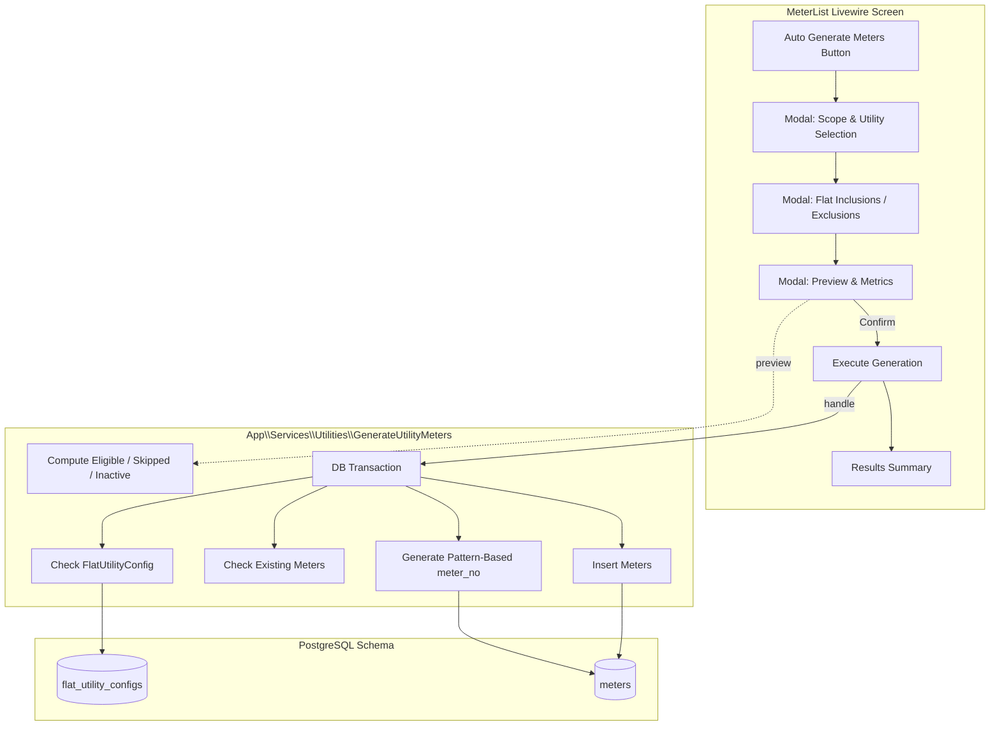

# Technical Design Specification: Automatic Utility Meter Generation and Flat-Based Meter Management

## 1. Overview & Objective

In apartment and building societies (Somobay Somiti), manually provisioning utility meters (electricity, gas, water, sub-meters) for buildings with 100+ units is time-consuming and error-prone. This feature introduces a robust, bulk meter generation engine with:
- Multi-scope targeting (Entire building, specific floors, or chosen individual flats).
- Idempotent execution preventing duplicate meters across repeated runs.
- Persistent flat-level utility configuration (`flat_utility_configs`) to handle units that do not have certain utilities (e.g. gas-free units).
- Pre-generation simulation & preview displaying counts of eligible units, skipped units, inactive meter warnings, and net creations.
- Zero accounting side-effects: physical meter provisioning does not fabricate readings or bill lines.

---

## 2. Architecture & Domain Design



### 2.1 Database Schema Changes

#### New Table: `flat_utility_configs`
Distinguishes whether a flat requires a particular utility from the physical meter lifecycle.
```sql
CREATE TABLE flat_utility_configs (
    id BIGSERIAL PRIMARY KEY,
    flat_id BIGINT NOT NULL REFERENCES flats(id) ON DELETE CASCADE,
    utility_id BIGINT NOT NULL REFERENCES utilities(id) ON DELETE CASCADE,
    is_enabled BOOLEAN NOT NULL DEFAULT TRUE,
    created_at TIMESTAMP NULL,
    updated_at TIMESTAMP NULL,
    CONSTRAINT flat_utility_configs_flat_utility_unique UNIQUE (flat_id, utility_id)
);
CREATE INDEX flat_utility_configs_utility_id_index ON flat_utility_configs (utility_id);
```

- When a record exists with `is_enabled = false`, that flat is permanently excluded from generation for that utility unless re-enabled.
- If no record exists, the flat is considered enabled by default.

### 2.2 Default Utility Seeding
A new seeder `UtilitySeeder` will ensure default utilities exist per building:
- **Electricity**: `name` = `'Electricity'`, `name_bn` = `'বিদ্যুৎ'`, `unit_label` = `'kWh'`, `sort_order` = 1
- **Gas**: `name` = `'Gas'`, `name_bn` = `'গ্যাস'`, `unit_label` = `'m³'`, `sort_order` = 2
- **Water**: `name` = `'Water'`, `name_bn` = `'পানি'`, `unit_label` = `'Unit'`, `sort_order` = 3
- Linked to the building's income account (resolving `Account` of type `Income`).
- Fully idempotent using `Utility::firstOrCreate`.

---

## 3. Core Service Implementation

### 3.1 Data Structures

```php
namespace App\Support;

class MeterGenerationPreviewData
{
    /**
     * @param list<array{flat_id: int, flat_number: string, utility_id: int, utility_name: string, reason: string}> $skippedDetails
     * @param list<array{flat_id: int, flat_number: string, utility_id: int, utility_name: string, meter_no: string}> $inactiveWarnings
     */
    public function __construct(
        public readonly int $totalFlatsCount,
        public readonly int $eligibleMetersCount,
        public readonly int $skippedMetersCount,
        public readonly int $excludedFlatsCount,
        public readonly array $skippedDetails = [],
        public readonly array $inactiveWarnings = [],
        public readonly array $utilityCounts = [],
    ) {}
}

class MeterGenerationResultData
{
    /**
     * @param list<string> $errors
     */
    public function __construct(
        public readonly int $flatsConsidered,
        public readonly int $metersCreated,
        public readonly int $metersSkipped,
        public readonly int $flatsExcluded,
        public readonly array $errors = [],
    ) {}
}
```

### 3.2 Service: `GenerateUtilityMeters`

```php
namespace App\Services\Utilities;

use App\Models\Building;
use App\Models\Flat;
use App\Models\Meter;
use App\Models\Utility;
use App\Support\MeterGenerationPreviewData;
use App\Support\MeterGenerationResultData;
use Illuminate\Support\Collection;
use Illuminate\Support\Facades\DB;

class GenerateUtilityMeters
{
    /**
     * @param list<int> $flatIds
     * @param list<int> $utilityIds
     * @param array<int, string> $utilityPrefixes
     * @param array<string, bool> $flatUtilityOverrides Array of "$flatId-$utilityId" => bool
     */
    public function preview(
        Building $building,
        array $flatIds,
        array $utilityIds,
        array $flatUtilityOverrides = [],
    ): MeterGenerationPreviewData {
        // Evaluate eligibility, active skipped, inactive warnings, and disabled configurations.
    }

    /**
     * @param list<int> $flatIds
     * @param list<int> $utilityIds
     * @param array<int, string> $utilityPrefixes
     * @param array<string, bool> $flatUtilityOverrides Array of "$flatId-$utilityId" => bool
     * @param bool $persistOverrides Whether to save flat_utility_configs
     */
    public function handle(
        Building $building,
        array $flatIds,
        array $utilityIds,
        array $utilityPrefixes = [],
        array $flatUtilityOverrides = [],
        bool $persistOverrides = true,
    ): MeterGenerationResultData {
        // Runs inside DB::transaction:
        // 1. Persists flat_utility_configs if requested.
        // 2. Checks existing meters for (flat_id, utility_id).
        // 3. Generates unique meter_no: {PREFIX}-{FLAT_NUMBER}.
        // 4. Inserts Meter with initial_reading = 0, digits = 6, is_active = true.
    }
}
```

---

## 4. UI/UX Workflow in `MeterList`

The Livewire component `App\Livewire\Utilities\MeterList` will be enhanced with a modal workflow:
1. **Trigger**: "Auto Generate Meters" button on the page header (authorized via `MeterPolicy::create`).
2. **Step 1: Selection & Scope**:
   - Filter flats by: "All Active Flats", "By Floor", or "Individual Flats".
   - Select Utilities via checkboxes with default prefix inputs (`ELEC`, `GAS`, `WTR`).
3. **Step 2: Flat Inclusions & Exclusions**:
   - Compact table listing selected flats and toggles for each selected utility.
   - Shows existing meter status (e.g., "Active Meter exists", "Excluded").
4. **Step 3: Preview**:
   - Cards: Total Flats, Meters to be Created, Skipped (Already Exist), Inactive Warnings.
   - Detail list of skipped units and reasons.
5. **Step 4: Confirmation & Summary**:
   - Action button: "Confirm & Generate Meters".
   - Success alert summarizing created count and skipped count.
   - Table immediately refreshes with newly generated meters.

---

## 5. Idempotency & Downstream Safety Guarantees

1. **Idempotency**: Running generation repeatedly against the same building/flats results in 0 duplicate meters; existing meters are detected and skipped.
2. **Inactive Meters**: Deactivated meters are flagged in preview warnings and skipped. They are never reactivated or replaced automatically.
3. **Double-Entry & Billing Invariants**:
   - No `MeterReading` rows are created during meter generation.
   - No `service_charge_bills` or `journal_lines` are created or modified.
   - Downstream billing (`MeterReadingLines`) strictly selects readings with `status = 'confirmed'`, guaranteeing complete isolation.

---

## 6. Testing Strategy

Automated PHPUnit tests in `tests/Feature/Utilities/GenerateUtilityMetersTest.php`:
1. Generate meters for 120 flats across multiple floors.
2. Generate multiple utility types (Electricity + Gas) simultaneously.
3. Skip flats that already possess an active meter for that utility.
4. Exclude selected flats via `flat_utility_configs` or explicit exclusion override.
5. Identify and skip flats with inactive meters with clear warning reporting.
6. Verify duplicate generation requests are 100% idempotent.
7. Verify tenant isolation: generation within Building A never touches Building B.
8. Verify transaction rollback on failure.
9. Verify downstream accounting safety: assert zero bill lines and zero journal entries are created.
10. Verify idempotent execution of `UtilitySeeder`.
